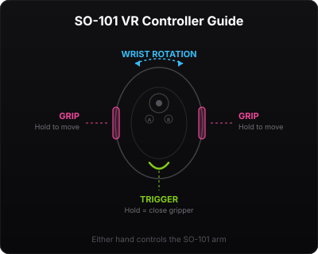

# SO-101 VR Control v2.0

Single-arm VR teleoperation for the [SO-101 robot arm](https://github.com/TheRobotStudio/SO-ARM100) via Meta Quest headsets. Browser-based WebXR — no app installation required.



## Features

- **WebXR in browser** — open a URL on your Quest, no app install
- **Single-arm optimized** — both VR controllers map to one arm
- **Calibration-safe kinematics** — joint limits tightened to actual motor range
- **Self-collision protection** — Z-floor enforcement, velocity limiting
- **Dark UI dashboard** — status, settings, keyboard fallback
- **PyBullet IK** — multi-reference pose inverse kinematics

## Hardware

| Component | Details |
|-----------|---------|
| Robot | SO-101 (6x STS3215 FEEtech servos) |
| VR Headset | Meta Quest 2 / Pro / 3 / 3S |
| Connection | USB serial |

## Quick Start

```bash
conda activate pi0
cd ~/telegrip
pip install -e .
so101-vr --left-port /dev/ttyACM0 --log-level info --no-viz
```

Open `https://<your-ip>:8443` on your Quest browser.

## VR Controls

| Action | Controller |
|--------|-----------|
| Move arm | Hold **GRIP** |
| Close gripper | Hold **TRIGGER** |
| Open gripper | Release **TRIGGER** |
| Wrist rotation | Controller orientation |

Either hand works — both are remapped to the single arm.

## Safety

- Joint limits tightened from motor calibration (5° margin)
- Velocity limited to 200°/s (10°/step at 20Hz)
- Ground collision prevention (Z-floor + post-IK FK check)
- LeRobot `max_relative_target = 10°` per command

## CLI Options

```
so101-vr [OPTIONS]

--left-port PORT    Serial port for the arm
--no-robot          Visualization only
--no-viz            Headless mode (no PyBullet GUI)
--no-vr             Disable VR WebSocket server
--autoconnect       Auto-engage motors on startup
--log-level LEVEL   debug | info | warning | error
```

## Credits

Based on [Telegrip](https://github.com/DipFlip/telegrip) by Emil Rofors. Modified for single-arm SO-101 operation with safety enhancements by GetSet Robotics.

## License

MIT
# SO-101-VR-Control
